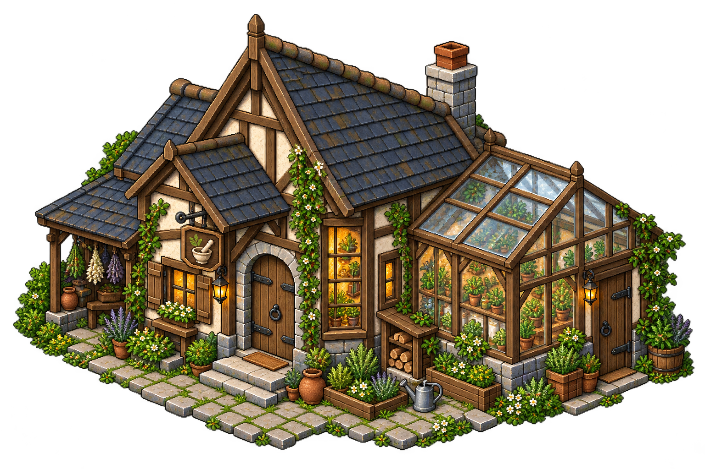
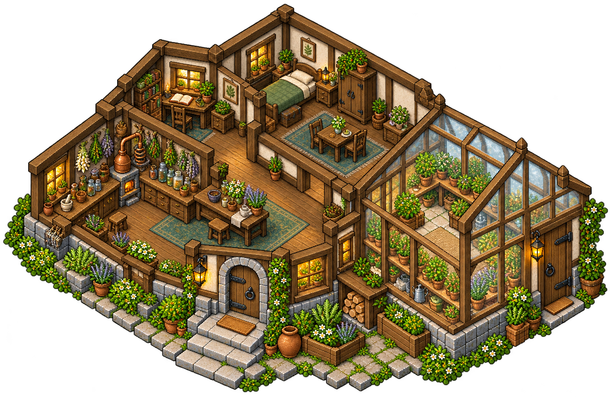

# Casa de Unamahloni — exterior e interior

**Integración parcial, 12 de octubre:** la prueba de isla reutiliza recursos de este lote mediante el registro `assets/mundo/isla-bitu/`, conservando las fuentes. Fachadas, muebles seleccionados o piezas de ruinas están integrados; las láminas completas y sus otros elementos siguen como referencias. Las afirmaciones anteriores de «sin integrar» describen la entrega original. [Alcance actual](../../../docs/isla-y-mochila-prueba.md).

Petición del **11 de octubre de 2026**: crear la casa del alquimista por fuera y por dentro y subir esta entrega a GitHub.

Unamahloni es el maestro alquimista/herboristero Veyari: metódico, curioso y estudioso de las plantas. Su hogar conserva la ubicación general norte/noreste del mapa de Bītu; coordenadas y límites pendientes.

## Exterior propuesto

Vivienda rural de piedra, madera y revoco claro, silueta asimétrica y cubierta azulada. Invernadero lateral y pequeños espacios para plantas. Entrada despejada y materiales coherentes con los demás edificios. El invernadero y el jardín son propuestas visuales, sin fijar cultivos ni un sistema nuevo.

## Interior propuesto

Laboratorio con mesa de preparación, utensilios y estantes; escritorio para estudiar plantas y fórmulas, zona doméstica y dormitorio separado. Conexión al invernadero lateral y circulación libre entre vivienda y taller. Frascos, plantas y utensilios dibujados son decoración propuesta: no establecen recetas, ingredientes, efectos, nuevas herramientas ni rituales confirmados.

## Estado de la entrega

Dos fuentes visuales creadas con generación de imagen y conservadas sin edición manual, con metadatos en `referencias/fuentes.json`. La fachada se referencia a los materiales/cámara de Bītu; el interior utiliza su propio exterior como guía de arquitectura.

Distribución y acabado pendientes de revisión. No son atlas nativos ni escenas jugables. Antes de integrar: limpiar fondo/halos, registrar recortes y escala respecto a adultos80px/suelo64×32, separar paredes y mobiliario para profundidad, medir pasillos/puertas, definir anclas y colisiones y programar la transición. Sin cambios de juego o descarga por esta entrega gráfica.
