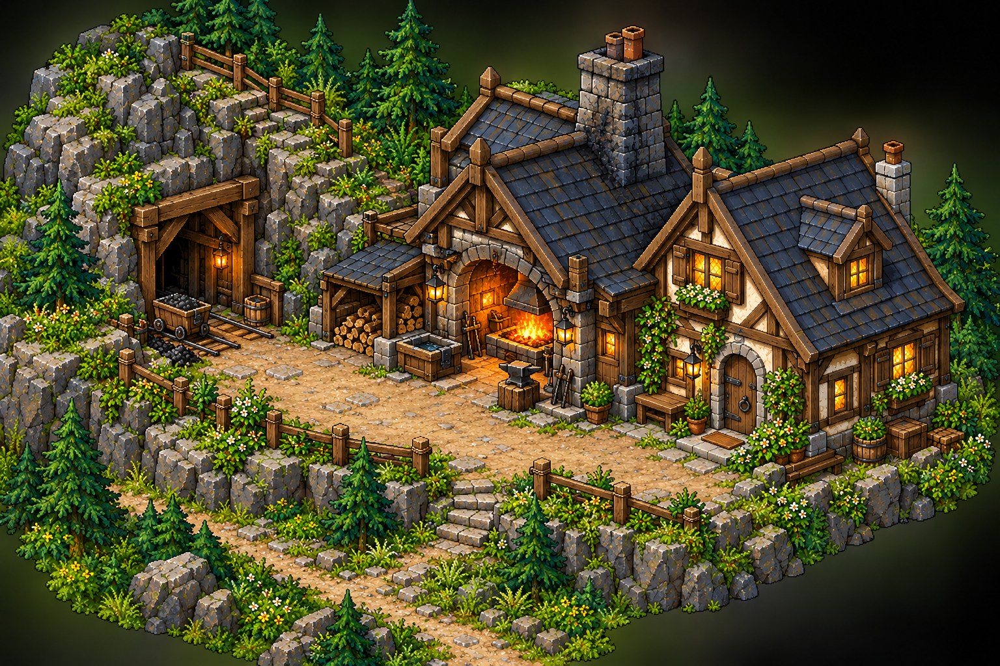
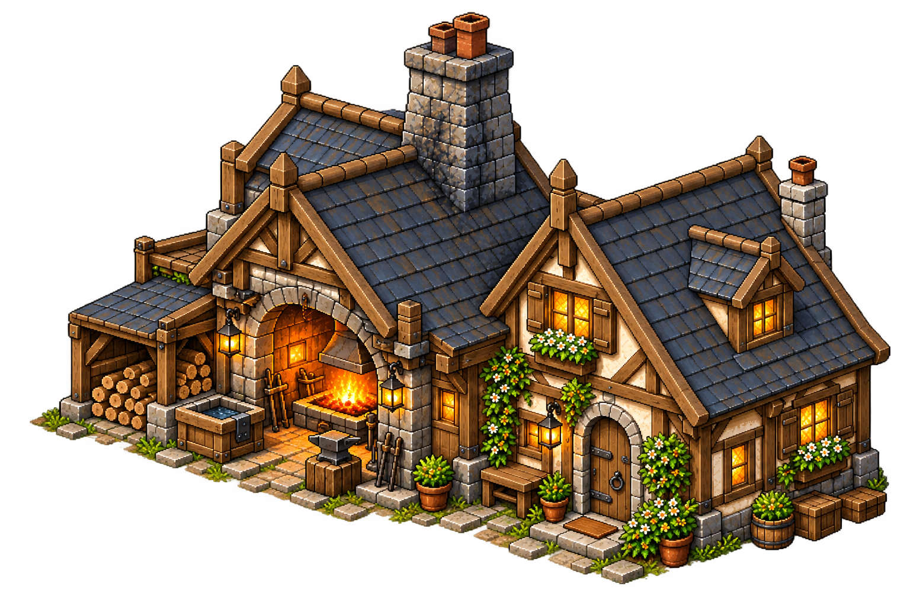
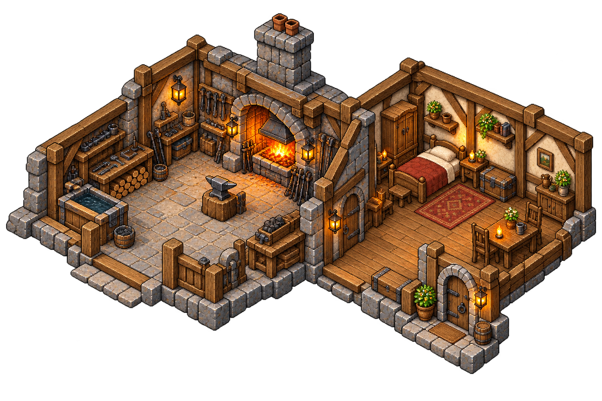
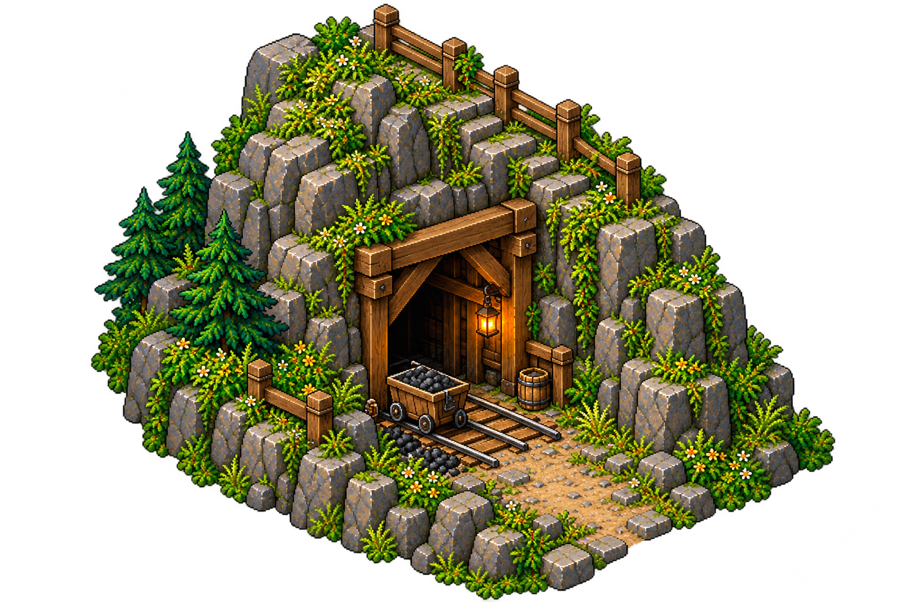
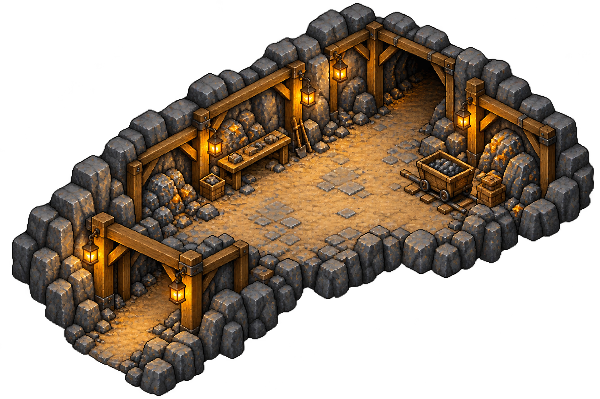

# Mina y herrería del maestro enano

Entrega del 11 de octubre de 2026. Exterior e interiores como fuentes visuales, con publicación solicitada por el usuario.

La herrería y la vivienda forman un conjunto: ala doméstica anexa, dormitorio separado del calor y humo de la forja. Mina cercana en el terreno montañoso del noroeste. El maestro sigue de visita con Flavia en el astillero al comienzo; estos dibujos no trasladan su residencia allí.

## Conjunto exterior

Patio de trabajo entre la entrada de la mina y la herrería, con paso despejado, piedra, madera, cubierta de pizarra, combustible protegido y zona de enfriado.

## Herrería y vivienda

Forja, yunque, banco de trabajo y almacenamiento; vivienda anexa con cama y espacio doméstico. Distribución y muebles son propuesta visual. No introduce armas, recetas ni materiales nuevos confirmados.

## Mina

Entrada reforzada, primera galería con soportes y luz de trabajo, espacio para caminar y continuidad hacia el fondo. No fija niveles, enemigos, desbloqueos ni equilibrio de minerales; vetas y utensilios son decoración de referencia.

## Preparación para el juego

Cinco imágenes fuente conservadas sin edición manual; metadatos y huellas en `referencias/fuentes.json`. Todavía no son módulos registrados ni escenas jugables.

Al construir los interiores, ampliar suelo útil y separación entre mobiliario manteniendo la escala de personajes y objetos. No estirar la imagen completa ni encoger al personaje. El conjunto exterior no fija distancias reales ni cuántas pantallas ocupa la zona.

Pendientes: recortes, limpieza de fondos/halos, división en capas y módulos, escala y anclas (adulto80px, enano64px, suelo64×32), colisiones estables, entradas y transiciones, profundidad y cámara. La publicación incluye referencias y documentación; no modifica el juego ni la descarga.
