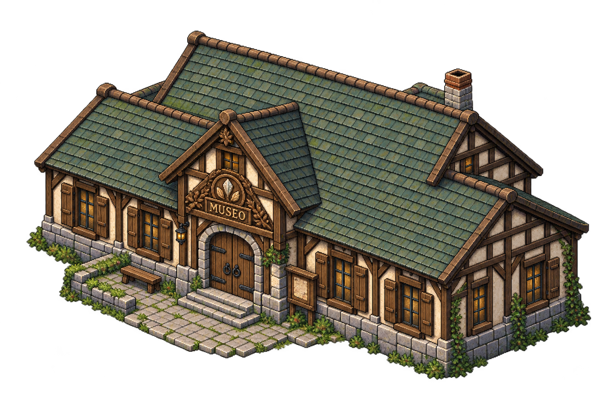
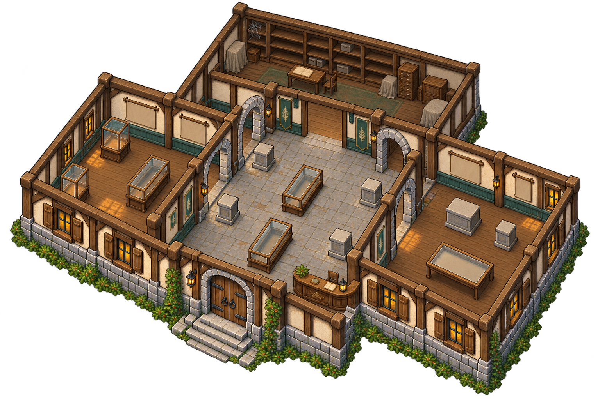

# Museo de Bītu — exterior e interior

Petición del **11 de octubre de 2026**: generar visualmente el exterior del museo y considerar un interior amplio para las colecciones. Petición posterior explícita: preparar exterior e interior y subir ambos a GitHub.

Fuentes: `referencias/museo-exterior-fuente.png` y `referencias/museo-interior-fuente.png`, creadas con generación de imagen y conservadas sin ediciones manuales. Referencias de perspectiva y materiales: casa rural y exterior del astillero existentes. Publicación de esta entrega autorizada. Son fuentes visuales para revisar, sin integración solicitada.

## Dirección visual

Edificio rural amplio: nave central alargada, alas laterales y cubierta alta, zócalo de piedra, entramado de madera oscura y revoco claro. Cubierta apagada verdosa para distinguirlo de la granja y el astillero. Entrada reconocible y despejada, ventanas de exposición y detalles botánicos discretos vinculados al carácter estudioso de la elfa.

El museo está abandonado al comienzo según el diseño vigente: desgaste, vegetación moderada y ventanas apagadas, conservando una estructura sólida. La intensidad del abandono, restauración y acceso concreto siguen pendientes. No se añaden habitantes, objetos donados ni nuevas mecánicas de restauración por el dibujo.

Comparte zona con comercio cerca de la granja; no cambia la geografía de Bītu ni obliga a reunir comercio y museo en un mismo edificio.

## Interior propuesto

Un vestíbulo de recepción con la responsable, una sala principal de exposición, salas laterales para distintas colecciones y una reserva/archivo posterior. Espacio para caminar entre vitrinas, pedestales y piezas grandes. Distribución, categorías, capacidad, ampliaciones y medidas no elegidas todavía; la lámina interior muestra una posible distribución, sin fijar el plano jugable.

Las donaciones son definitivas y se registran en la colección del jugador, según el acuerdo existente. El dibujo no implementa ese registro ni fija que cada ejemplar deba ocupar una casilla independiente. Las piezas de exposición y las conservadas en reserva podrán organizarse al diseñar el sistema; esa organización sigue como propuesta.

## Preparación para el juego pendiente

Las láminas no son sprites nativos registrados ni un edificio jugable. Medir recorte, escala respecto a adultos de 80 px y suelo 64 × 32, ancla de entrada y apoyo, profundidad/capas, colisiones y acceso. El interior podrá tener su propia escena y cámara; extensión y transiciones pendientes. No estirar la imagen para crear espacio interior.

## Dibujos

### Exterior

### Interior

Vitrinas y pedestales vacíos para futuras colecciones; depósito/archivo separado
del espacio de exposición. El mobiliario dibujado es una propuesta, no un
catálogo definitivo ni piezas registradas individualmente. El abandono visual
no establece tareas de restauración obligatorias.

Antes de integrar: comprobar y limpiar fondo/halos, separar paredes y mobiliario
para profundidad, medir puertas/pasillos con el personaje y registrar piezas
reutilizables. Metadatos de las fuentes en `referencias/fuente.json`.
