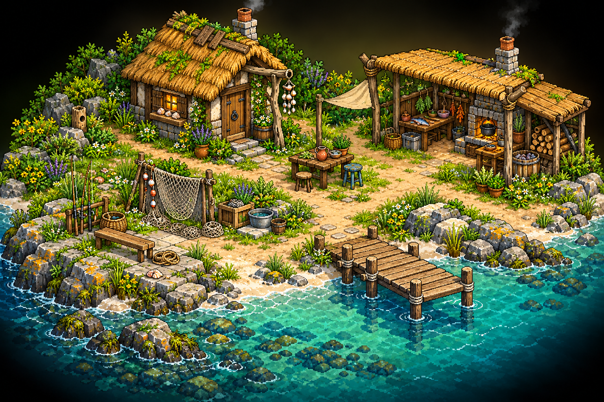
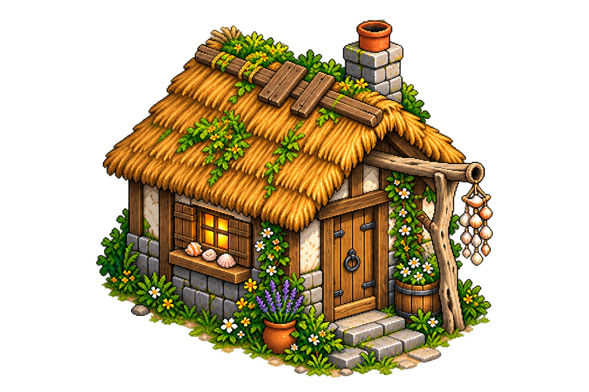
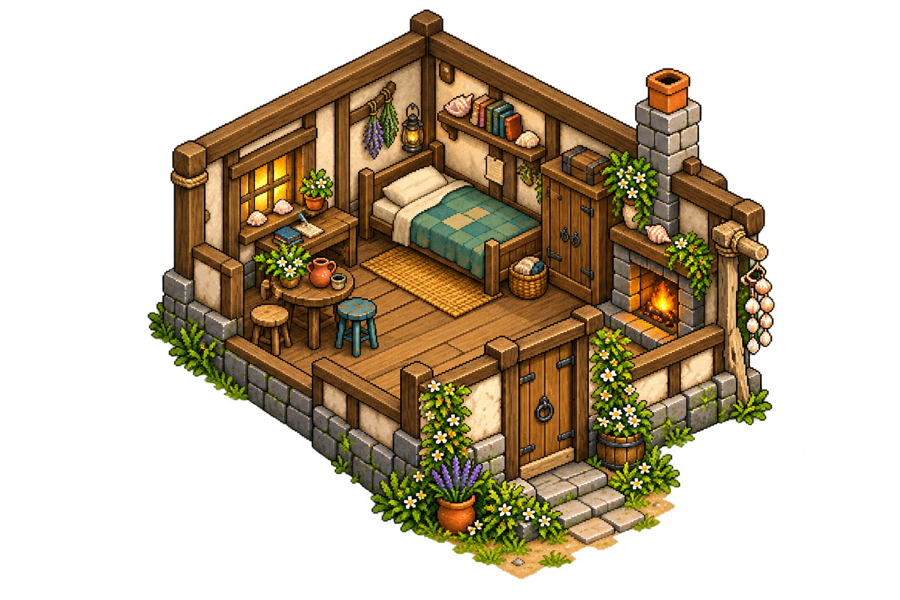
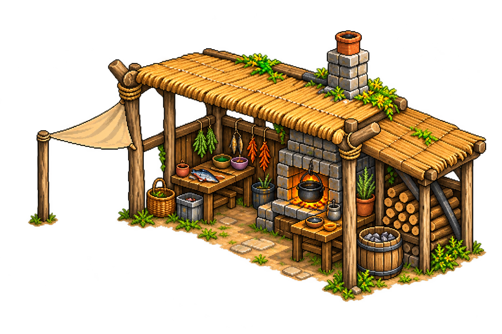
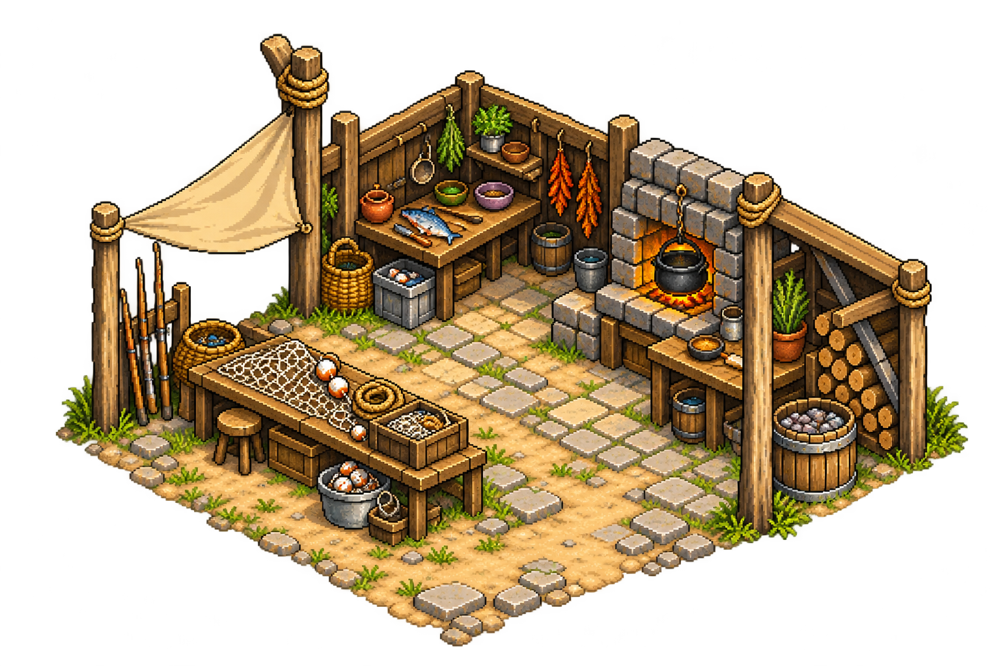

# Parcela del maestro cocinero/pescador

**Integración parcial, 12 de octubre:** la prueba de isla reutiliza recursos de este lote mediante el registro `assets/mundo/isla-bitu/`, conservando las fuentes. Fachadas, muebles seleccionados o piezas de ruinas están integrados; las láminas completas y sus otros elementos siguen como referencias. Las afirmaciones anteriores de «sin integrar» describen la entrega original. [Alcance actual](../../../docs/isla-y-mochila-prueba.md).

Petición del **11 de octubre de 2026**: crear una parcela con espacio para pescar, pequeña choza con cama y detalles adicionales, incluyendo exterior e interior de la choza y cualquier otra estructura. Publicación posterior solicitada expresamente.

Se conserva el maestro anciano, excéntrico, buen conversador y amante de la naturaleza. Nombre y especie pendientes. La parcela mantiene su ubicación general costera al suroeste de Bītu y el sendero de conexión con la granja; posición exacta y límites sin fijar.

## Conjunto exterior

Choza para dormir, cobertizo abierto de cocina/pesca y patio entre ambos. Puesto de pesca en la orilla, pequeño muelle, mesa exterior, rincón de reparación de redes, leña, cestas, lavado y plantas aromáticas. Conchas, madera de deriva y reparaciones hechas a mano sugieren el carácter del maestro sin copiar un personaje de referencia.

La parcela es el hogar y terreno del maestro, no una casa grande ni un restaurante. El cobertizo reúne instalaciones de oficio aparte de la vivienda. Los adornos y utensilios son propuestas visuales: no fijan recetas, cebos, capturas, nuevas herramientas, especies ni sistemas de secado/lavado.

## Choza

### Exterior

### Interior

Cama sencilla, espacio doméstico, armario/cofre de pertenencias y rincón de lectura/recuerdos del mar. Distribución y muebles propuestos, conservando una vivienda pequeña y una entrada libre.

## Cobertizo de cocina y pesca

### Exterior

### Interior

Hogar de cocina seguro bajo cubierta ventilada, preparación de alimentos, almacenamiento seco y reparación/guardado de equipo de pesca. Separar las zonas caliente y de redes y dejar pasos despejados. La condición de abierto permite que su zona de trabajo pueda estar en el exterior jugable, sin obligar a una transición por entrar bajo el tejado.

## Escala y preparación pendiente

Cinco fuentes visuales conservadas sin edición manual. Metadatos en `referencias/fuentes.json`. No son sprites registrados, prefabs con colisiones ni zonas jugables.

Usar los interiores como referencia y darles más suelo útil al construirlos in-game, conservando escala del personaje/mobiliario y el carácter de choza pequeña. No estirar la lámina completa ni encoger al personaje. El conjunto exterior comprime distancias; no fija cuántas pantallas ocupa la parcela.

Antes de integrar: recortar y separar estructuras/muebles, limpiar fondo/halos de las fuentes aisladas, ajustar escala y anclas con adulto80px/suelo64×32, comprobar paredes/entradas/muelle-orilla y colisiones, profundidad y cámara. Transición de la choza pendiente; muelle/puesto de pesca sin interacción implementada por estos dibujos. No se modifica el juego ni la descarga con esta publicación.
