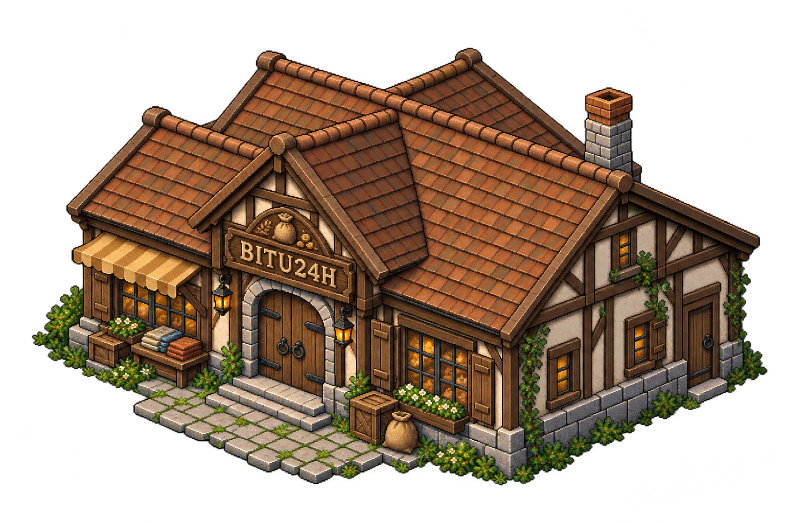
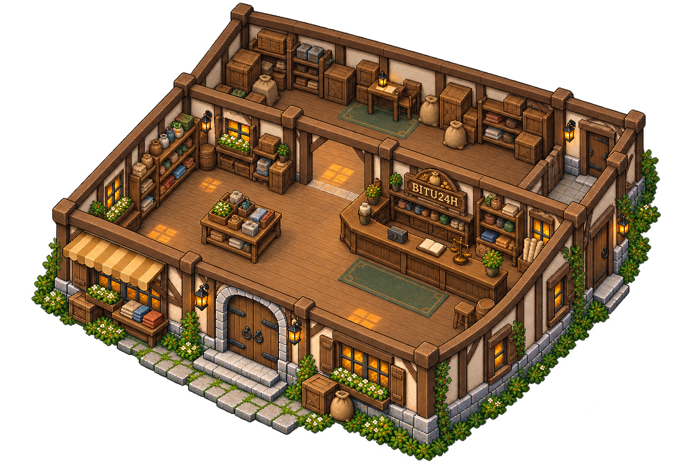

# BITU24H — tienda de Bītu

**Integración parcial, 12 de octubre:** la prueba de isla reutiliza recursos de este lote mediante el registro `assets/mundo/isla-bitu/`, conservando las fuentes. Fachadas, muebles seleccionados o piezas de ruinas están integrados; las láminas completas y sus otros elementos siguen como referencias. Las afirmaciones anteriores de «sin integrar» describen la entrega original. [Alcance actual](../../../docs/isla-y-mochila-prueba.md).

Petición del **11 de octubre de 2026**: hacer lo mismo que con el museo, preparando exterior e interior y su publicación como referencias visuales.

**Nombre elegido: BITU24H. El usuario aclara que no abre las 24 horas.** Horario concreto pendiente; el nombre no impone disponibilidad permanente ni un sistema de horarios por esta entrega.

## Exterior

Edificio rural de piedra, madera y revoco claro, con tejado cálido marrón/terracota, toldo ocre y rótulo del comercio. Entrada central despejada y acceso lateral de servicio. Coherente con el museo, con fachada y volumen propios. Comparte su zona cerca de la granja, conservando edificios separados y pocos habitantes.

## Interior

Sala de venta, mostrador del comerciante, estantes perimetrales, expositor bajo y almacén trasero conectado. Espacio para entrar, llegar al mostrador y moverse entre muebles; acceso de servicio al almacén. Los productos genéricos del dibujo son decoración propuesta, no catálogo, precios ni objetos nuevos confirmados para el juego.

Se reserva la posibilidad de ampliar sala o almacén en un futuro. Dimensiones, disposición exacta y forma de conseguir esas ampliaciones pendientes. No se fijan obras obligatorias, costes ni desbloqueos por este diseño.

## Estado y preparación pendiente

Dos fuentes de generación de imagen conservadas sin edición manual, usando el museo como referencia de materiales y cámara y la fachada propia como referencia del interior. Metadatos en `referencias/fuentes.json`.

Son ilustraciones para revisar, no atlas registrados ni escenarios jugables. Antes de integrar: limpiar fondo/halos, medir recortes y escala con adulto de 80 px y suelo 64 × 32, separar paredes/muebles, registrar anclas, comprobar entradas y pasillos, crear colisiones e implementar la transición al interior. No se modifican juego ni descarga con esta entrega.
