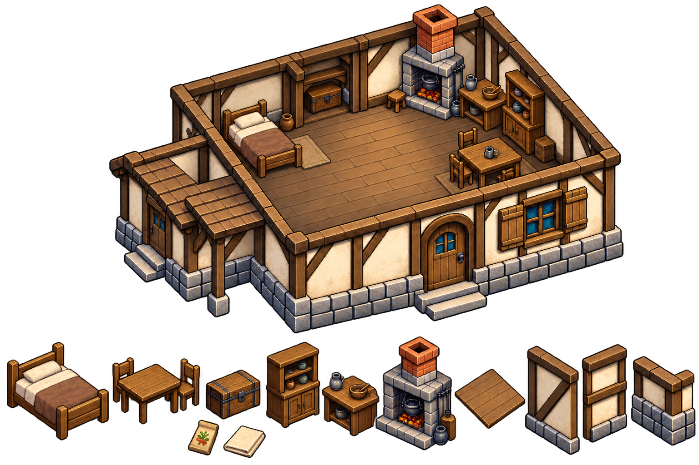
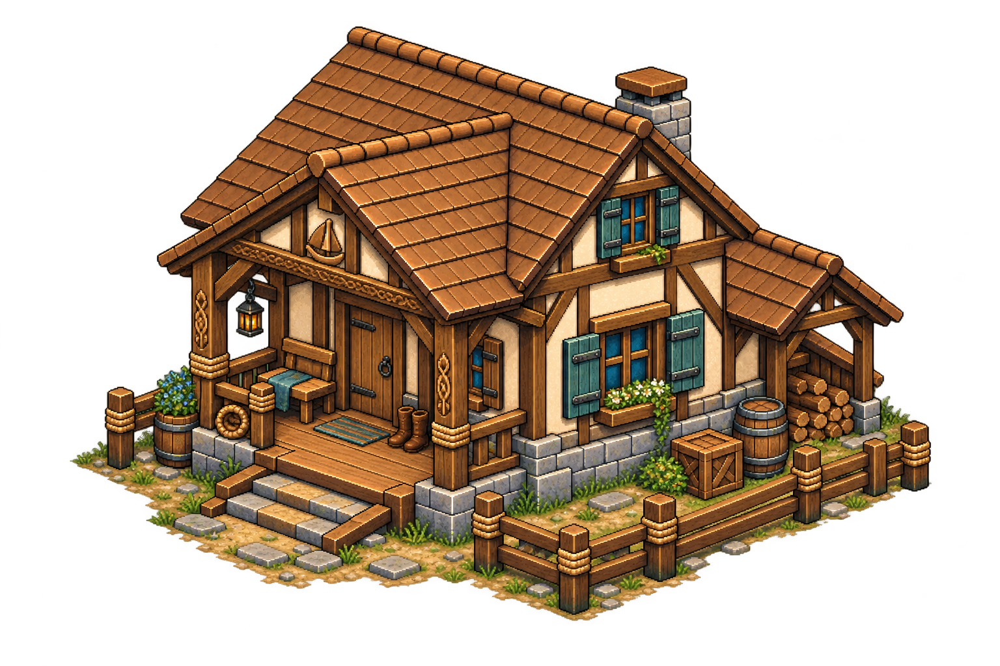
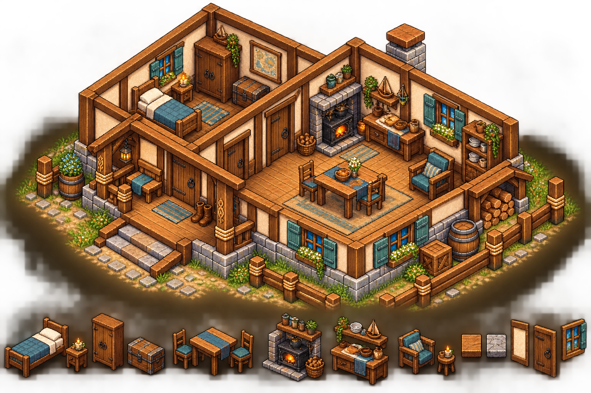
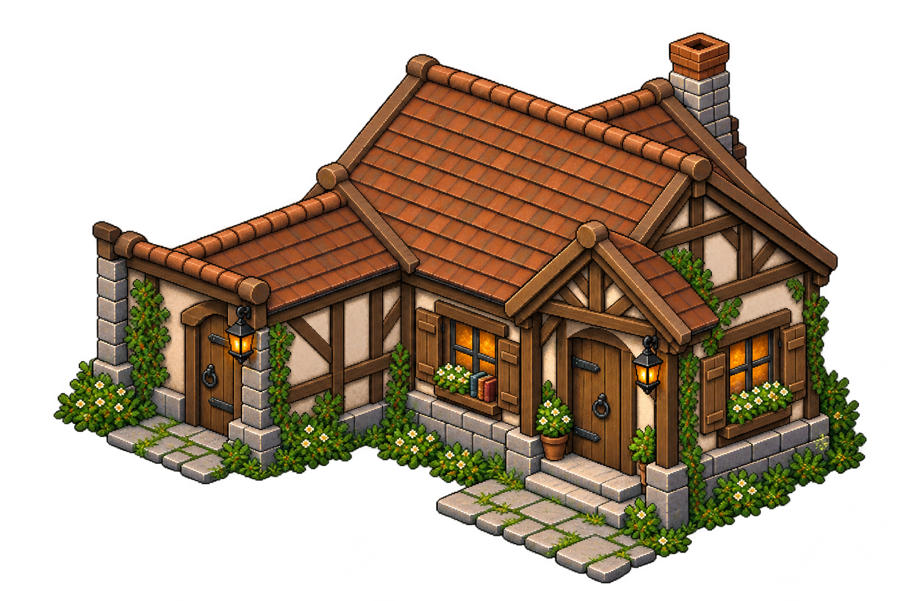
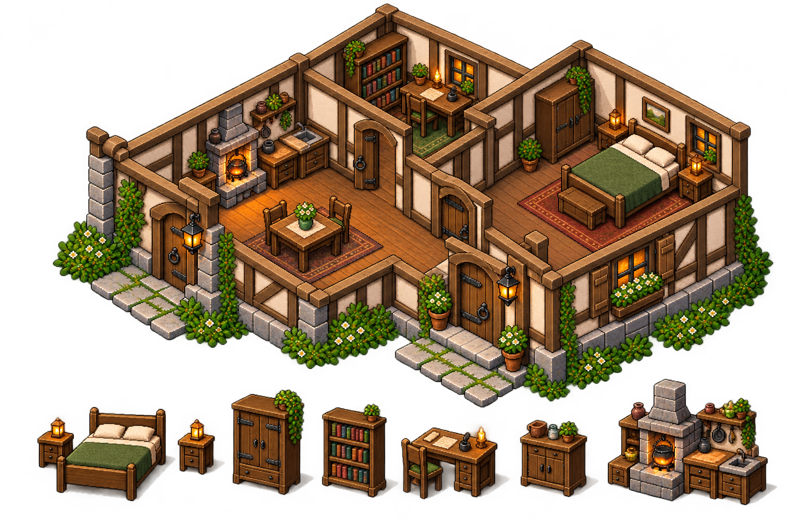
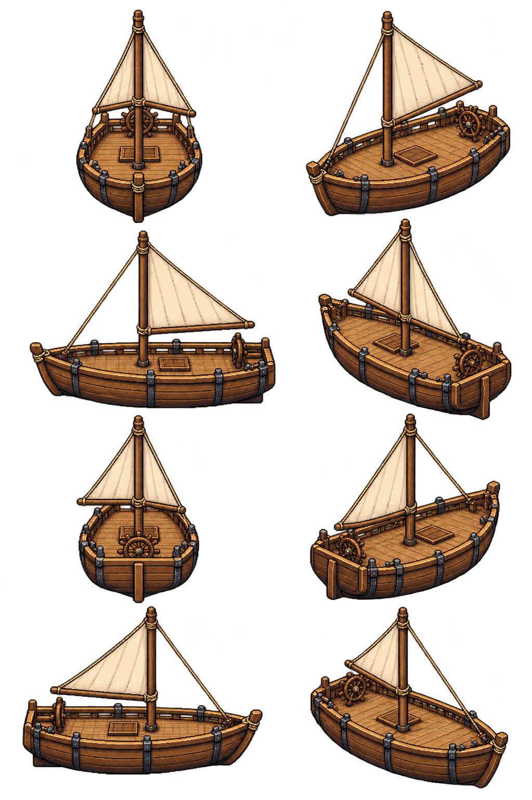
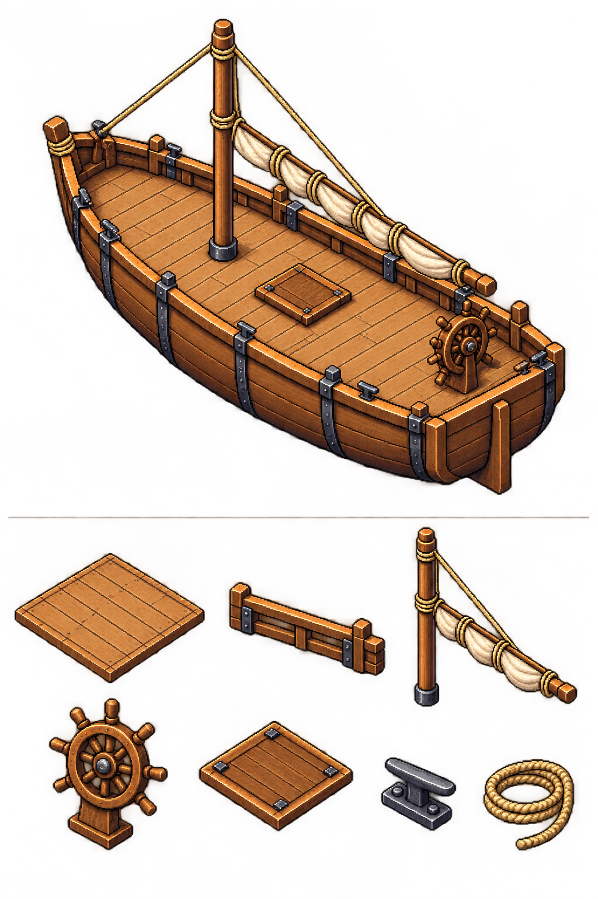
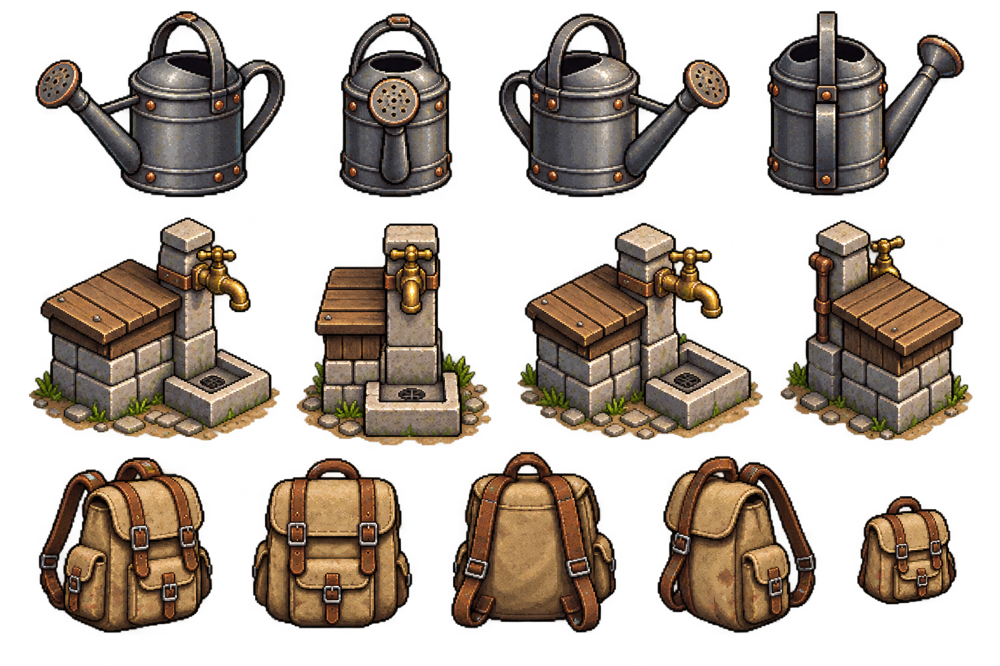
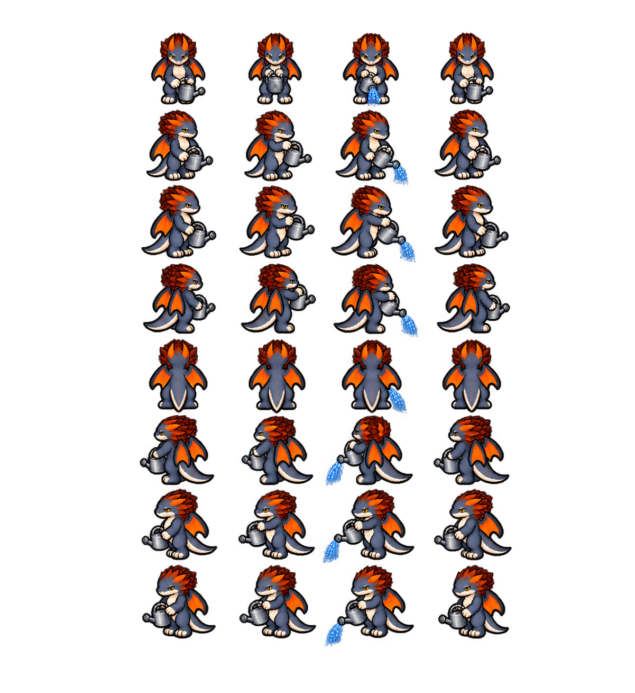
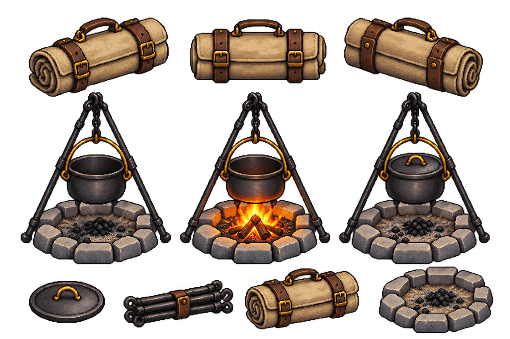

# Assets pendientes del núcleo inicial de Bītu

Entrega del 11 de octubre de 2026 solicitada tras auditar huecos. Publicación autorizada; sin integración por esta petición.

## Interior de nuestra casa

Abierta y modesta, cocina sencilla, cama, mesa y cofre oculto. Abandonada pero habitable; no revelar la historia del antiguo maestro.

## Casa independiente de Flavia: exterior

Vivienda en el terreno del astillero, lenguaje de madera/piedra y detalles marítimos.

## Casa de Flavia: interior

Dormitorio separado y cocina/salón acogedor, accesos y suelo útil despejados.

## Vivienda anexa a BITU24H: exterior

Anexo doméstico compartido por comerciante y elfa, acceso propio y conexión con tienda. No sustituye almacén.

## Vivienda de la pareja: interior

Dormitorio para ambos, salón/cocina y estudio de la elfa. Detalles personales propuestos, sin nueva historia.

## Primer barco: vistas

Velero de trabajo pequeño elegido por delegación: ocho orientaciones propuestas con mastil/vela, cubierta transitable y timón. Escotilla cerrada; no interior inicial.

## Cubierta del barco

Vista de distribución y piezas separadas para preparar el paso alrededor del mástil y acceso al timón; lugar para pescar. Distribución y dimensiones aún por calibrar.

## Regadera, punto de agua y mochila

Regadera básica, grifo rústico/cisterna y mochila en vistas separadas. Capacidades, consumo y mejoras pendientes; no añade gestión de reservas de cisterna.

## Propuestas de fases de riego

Fuente de poses del protagonista con regadera en varias direcciones, trasladada sin alterar sus bytes a [las referencias del dragón](../../personajes/dragon/referencias/README.md). No sustituye atlas vigente ni implica que animación, agarres y escala ya estén registrados/validados.

## Kit portátil de cocina

Empaquetado, desplegado apagado y activo, utensilios separados. Combustible, adquisición, recetas, costes y tiempos pendientes.

## Acuerdos y alcance

Confirmados en las respuestas del usuario: casa del jugador abierta/modesta con rincón de cocina; casa de Flavia independiente y acogedora con dormitorio separado/cocina-salón; vivienda compartida de comerciante/elfa anexa a BITU24H. Diseño del barco delegado: propuesta de velero de trabajo, no mejora interior disponible al comienzo.

Las referencias de edificios creadas anteriormente se conservan. Los anexos son módulos nuevos, no fachadas de reemplazo ni conexión ya comprobada en el motor. El cofre oculto no establece un almacén doméstico general; la carta no tiene texto ni revelaciones nuevas.

Diez fuentes generadas, originales intactos: nueve en esta entrega y la de riego en las referencias del dragón. Son láminas de diseño, no atlas nativos listos para juego. Metadatos, dimensiones y huellas en `referencias/fuentes.json`. Comprobación de PNG y enlaces no equivale a prueba de animación o escenas en Godot.

Pendiente: limpiar fondos/halos, separar módulos y fotogramas, corregir continuidad si hace falta, registrar escala/anclas/agarres (adulto/protagonista80px, enano64px, suelo64×32), colisiones, capas y profundidad, transiciones, movimiento del barco y animación de riego. Mantener más suelo útil en interiores al construirlos, sin ampliar globalmente las láminas ni encoger personajes. Vistas de barco y fases de riego son propuestas para revisar por dirección/fase, no promesa de movimiento ya terminado.

Este lote cubre los huecos enumerados de viviendas y equipo inicial; no cierra todo el arte del juego. Futuras islas, enemigos, colecciones, catálogo de materiales/recetas y mejoras necesitan su definición correspondiente.
