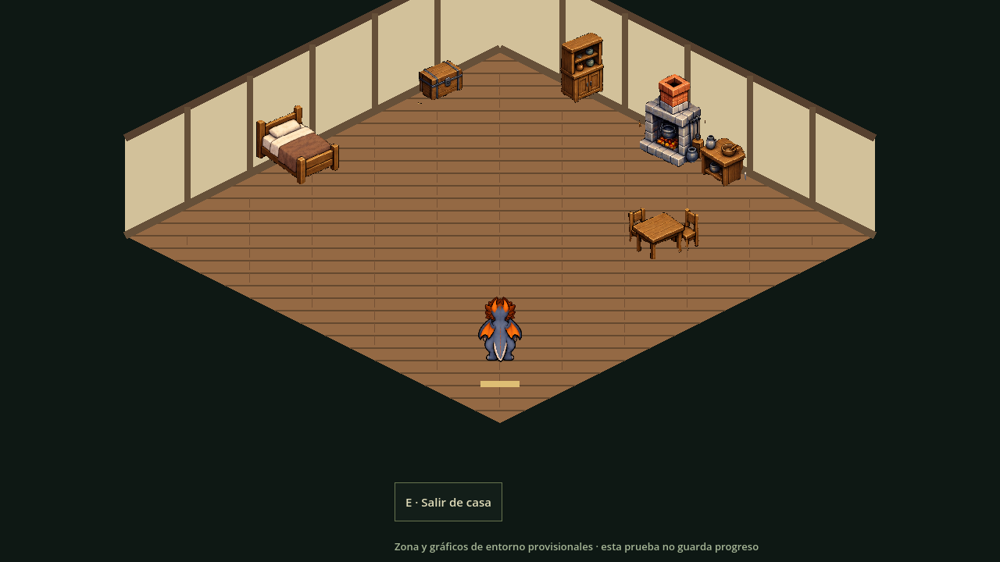
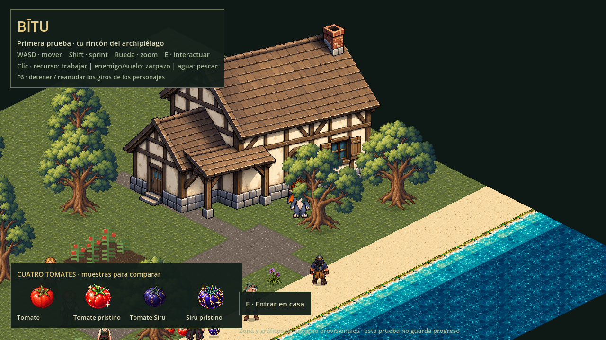

# Casa e interior en la prueba

11 de octubre de 2026. Integración solicitada y publicación autorizada.

La casa exterior existente conserva sprite, escala y cimientos completos. Acercarse a la puerta frontal y pulsar **E** abre el interior mediante dos fundidos de0,15s. E cerca de la franja de salida devuelve al patio delante de la misma puerta. WASD, sprint y zoom conservados. En navegador `?vista=casa` permite revisar directamente el interior y salir al exterior.

Interior con más suelo útil, cama, mesa, cofre, armario, cocina y hogar. Muebles mediante regiones AtlasTexture de la fuente aprobada, compartiendo un PNG; sin editar sus píxeles. Suelo y paredes construidos por dibujo estático, filtro nearest. Cámara acotada al interior y personaje a su escala vigente. Paredes y muebles tienen colisión; no son una lámina estirada con el personaje encima. Cofre/cama/cocina son decorativos en esta entrega: no inventa almacenamiento ni recetas.

Jugador, inventario y granja se conservan. Al cambiar se cancela trabajo/pesca, se bloquean controles durante el fundido y se fija cámara en negro; pulsaciones repetidas no duplican transición. El exterior permanece en memoria, oculto y con su árbol desactivado mientras se visita esta única habitación; sus temporizadores de cultivo/recurso/botín se mantienen desde el controlador. En negro no avanzan esos temporizadores. No es todavía la carga/descarga general por zonas ni un guardado persistente. El juego sigue reiniciándose al cerrar/recargar.

## Colocación de estructuras — criterio del usuario

Colocar estructuras sin huecos residuales detrás, a los lados, en esquinas o entre edificios y límites. Reservar huella continua y rematar uniones con terreno/vegetación/límite visible y colisión coherente; ningún pequeño pasillo accidental, bolsillo donde atascarse ni zona caminable escondida bajo un sprite. Los pasos traseros/laterales solo se conservan si son recorridos deliberados, legibles y suficientemente anchos. No llenar todo espacio abierto del mapa ni bloquear patios útiles por esta regla.

En esta prueba la casa conserva su huella sólida y el interior tiene perímetro cerrado, muebles de pared junto a sus límites y centro transitable. La regla se aplica al colocar nuevas estructuras y al revisar el mapa definitivo; esta entrega no reorganiza todos los edificios de Bītu.

## Validación

Godot4.6.3: `interior-smoke.gd` comprueba entrar/salir, solicitudes repetidas, visibilidad, movimiento, pared, regreso seguro y conservación de estado; también pasan `environment-smoke.gd` y `actions-smoke.gd` (exterior, pesca y zarpazo). Navegador Chromium/WebGL: acceso inicial `?vista=casa`, salida y segunda entrada mediante E, sin errores de script; capturas reales arriba. Descarga regenerada con `export_web.py`.

Acabado de paredes, anclas finas y distribución pueden revisarse visualmente después. El mecanismo está integrado solo para nuestra casa; demás interiores siguen pendientes.
