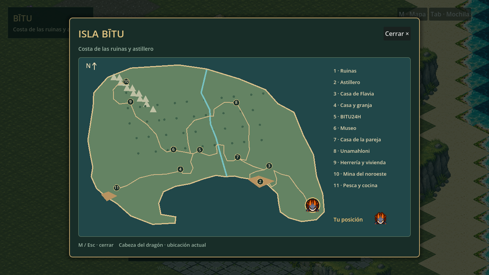
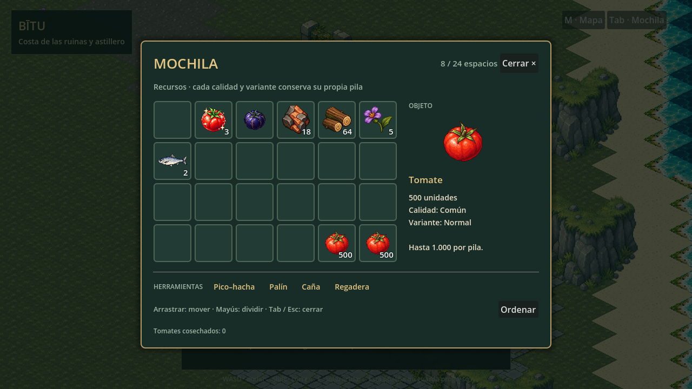

# Isla, mapa y mochila — prueba del 12 de octubre de 2026

La partida comienza en las ruinas costeras del este. El sendero conduce al astillero y conecta los demás lugares de Bītu. Es una distribución jugable de prueba basada en la geografía acordada, no una aprobación definitiva de distancias ni una implementación de toda la progresión del juego.

## Lugares y habitantes

| Lugar | Posición del acceso | Habitante en el exterior |
|---|---|---|
| Ruinas |3520,1880| Protagonista al comenzar |
| Astillero |1830,1120| Taller y muelle disponibles |
| Casa de Flavia |2120,610| Flavia |
| Casa y granja |−750,720| Vivienda del jugador |
| BITU24H |−120,90| Comerciante |
| Museo |−970,80| Vitrinas vacías |
| Vivienda de la pareja |1100,330| Elfa del museo |
| Casa de Unamahloni |1060,−1430| Alquimista/herboristero |
| Herrería y vivienda |−2360,−1460| Minero/herrero |
| Primera galería |−2500,−2110| Tres menas extraíbles |
| Pesca y cocina |−2810,1320| Cocinero/pescador |

La colocación del herrero en su propiedad responde a esta petición de comparación de hogares; no implementa ni descarta su futura visita narrativa al astillero. Herramientas y mochila están disponibles para probar acciones, sin simular regalos ni diálogos finales. Los seis habitantes mantienen sus ocho vistas y giros breves existentes.

El exterior tiene seis regiones: costa inicial, vecinos, granja, bosque norte, bosque oeste y montañas. Mantiene coordenadas continuas, cámara móvil y fundido breve al cruzar límites. Dos puentes permiten atravesar el río; dos muelles prolongan la costa. Senderos comprobados con la colisión real del personaje.190 árboles cosechables, menas, flores, parcelas y maniquí reutilizan los sistemas existentes.

Diez entradas con **E** conducen a viviendas, taller, comercio, museo, herrería y mina. Las habitaciones tienen suelo amplio, mobiliario con colisión y plantas adaptadas a su función. Salida en el mismo umbral; inventario y estado exterior se mantienen durante la sesión. El museo conserva vitrinas vacías; tiendas, laboratorio, cocina y forja son espacios de prueba, sin nuevos servicios ni recetas.

## Controles y menús

- WASD caminar, Mayús correr, rueda cambiar zoom.
- **M:** abrir/cerrar mapa. La cabeza del dragón señala la posición exterior real; dentro de una sala indica la propiedad correspondiente. Caminos, río, muelles y once destinos proceden del mismo JSON que el mundo.
- **Tab:** mochila con cuadrícula 6×4, detalle del objeto y herramientas aparte. Pilas hasta 1.000, mostradas como «1k»; cantidades exactas en detalles. Calidades y variantes conservan pilas distintas.
- Arrastrar mueve, intercambia o reúne pilas compatibles; Mayús+arrastrar divide a la mitad. Ordenar reúne y ordena sin perder objetos. Arrastre cancelado conserva la pila original.
- Mapa y mochila consumen los clics y pausan partida, acciones y tiempos. Esc cierra; E junto a un acceso entra/sale con fundido.
- Clic sobre recurso cercano inicia toda la extracción; agua cercana permite pescar y suelo libre permite zarpazo. Minería/tala conservan cinco golpes y sus animaciones vigentes. Botín recogido por proximidad, incluido en la mina.

El menú tiene diseño propio verde y latón. Se adapta a la ventana conservando los 24 huecos. No incluye fabricación, equipamiento manual, ampliaciones ni venta. La capacidad 24/1.000 sustituye12/50 de documentos históricos.

## Archivos y comprobación

Geografía canónica: `assets/mundo/isla-bitu/isla.json`. Registro: `edificios.json`,22PNG nativos: nueve fachadas y trece muebles. Copias idénticas en `prueba/assets/mundo/isla-bitu/`. Fuentes anteriores intactas, con bytes y SHA-256 registrados. Ruinas: reutilización de los atlas, prefabs y catálogo existentes. No se generan nuevas ilustraciones ni se modifican PNG del dragón o NPC.

`prueba/tools/register_island.py` reproduce la importación mediante Godot: recorte completo de fachadas, recortes de muebles existentes, escala uniforme nearest y exclusión de franjas de alfa casi transparente. No modifica fuentes. `bake_island_assets.gd` realiza el empaquetado. El juego dibuja terreno próximo a cámara y desactiva objetos de regiones inactivas; los interiores visitados quedan en caché durante la sesión. No se afirma streaming ni medición de memoria definitiva.

Pruebas reproducibles: `tests/island-smoke.gd` (senderos con colisión, seis hogares, diez entradas/salidas, mina, captura/botín desde el muelle, cruce andando entre regiones, cobertura del terreno, mapa y pausa), `tests/backpack-smoke.gd` (cantidades, división, intercambio y ordenación), regresiones vigentes del dragón, recursos, pesca, NPC y escala. `tools/island_browser_smoke.py` utiliza Chromium/WebGL y teclado/ratón; sus lecturas de estado se habilitan únicamente con `?verificar=1`.

Revisión directa opcional: `?lugar=flavia`, `tienda`, `museo`, `pareja`, `alquimista`, `herreria`, `mina`, `pescador`, `astillero` o `granja`; `?vista=casa` abre la vivienda del jugador. `?vista=granja` conserva la escena anterior. `?muestra=mochila` añade objetos de demostración solo al solicitarlo; la partida normal comienza sin ese lote.

## Límites pendientes

No guarda progreso. Sin navegación, economía, regalos narrativos, misiones, horarios ni nuevos enemigos. Edificios y salas están montados como prototipo para comprobar escala, recorrido y ubicación; su decoración y el acabado gráfico siguen sujetos a revisión. Los dibujos de riego siguen como referencias, sin nueva animación integrada. La revisión del dragón del 11 de octubre se conserva y no supone aprobación visual nueva.

Descarga actual de la isla: **38.240.383 bytes**, por debajo del límite de **104.857.600 bytes** por archivo. CRC verificado y PCK idéntico al exportado. SHA-256: `3dc2ab3fe4016b85a25cffebefb233c40381b2e8b6b303662328f2a1696085fd`. No requiere dividirse.

**Validación de la entrega:** doce pruebas Godot superadas y última pasada Chromium/WebGL completa sin errores de script: posición móvil del mapa,24huecos/1k, arrastre/división, ajuste a ventana pequeña y entrada/salida de los diez interiores. Mina y pesca con captura/botín comprobadas dentro de la isla; cruce exterior real y cobertura del terreno verificados. Se corrigió una franja sin dibujar en los límites de cámara antes de publicar.
